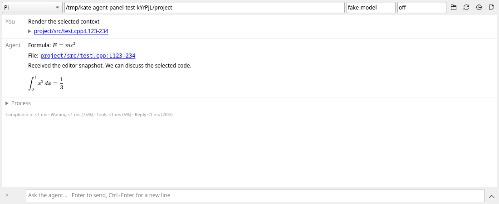

# Kate Agent Panel

Bring your agent CLIs into Kate's bottom panel, beside Terminal and Diagnostics.

## Overview

- A compact, left-aligned conversation using Kate's colors and fonts.
- A fixed bottom composer, with reasoning, tool calls, and logs collapsed under **Process**.
- Editor selections and cursor lines staged in **Pending**, including unsaved edits.
- Clickable workspace references and local Markdown/LaTeX rendering.
- Adapters for Pi, Codex, Claude Code, Kimi Code, Hermes, DeepSeek Harness, and ZCode.

The plugin discovers installed commands and inherits their environment. Agent
installation, authentication, model selection, and configuration stay with each CLI.

## Screenshot



The native panel with a local test agent. The sample shows a staged selection,
inline and display math, and collapsed process output.

## Requirements

- **Runtime:** Kate built with Qt 6 / KDE Frameworks 6, Qt WebEngine, Python 3.10+,
  and at least one configured agent CLI available on `PATH`.
- **Build:** a C++20 compiler, CMake 3.22+, Extra CMake Modules 6, Qt 6.5+
  development packages (Widgets, WebEngineWidgets, WebChannel), and KDE Frameworks 6
  development packages (CoreAddons, TextEditor, XmlGui, I18n).
- **Tests:** Qt Test, Node.js 18+, `flock`, and a display server or Xvfb.

Build against the Qt and KDE libraries used by your Kate installation. Local
validation uses Linux; see [testing](docs/testing.md) for the verified environment.

## Build

On Fedora, install the build and runtime dependencies first:

```sh
sudo dnf install kate git gcc-c++ cmake make ninja-build extra-cmake-modules \
  qt6-qtbase-devel qt6-qtwebengine-devel qt6-qtwebchannel-devel \
  kf6-ktexteditor-devel kf6-kcoreaddons-devel kf6-kxmlgui-devel kf6-ki18n-devel \
  python3
```

`extra-cmake-modules` provides `ECMConfig.cmake`. The `-devel` packages provide the
headers and CMake configuration files required to build the plugin.

For tests, also install:

```sh
sudo dnf install nodejs xorg-x11-server-Xvfb xorg-x11-xauth util-linux \
  dejavu-sans-fonts google-noto-sans-cjk-fonts
```

Clone the repository and configure a release build for installation under `~/.local`:

```sh
git clone https://github.com/gtg2619/kate-agent-panel.git
cd kate-agent-panel
cmake -S . -B build \
  -DCMAKE_BUILD_TYPE=Release \
  -DBUILD_TESTING=OFF \
  -DCMAKE_INSTALL_PREFIX="$HOME/.local" \
  -DKDE_INSTALL_PLUGINDIR=lib/qt6/plugins
cmake --build build --parallel 4
```

To try the build without installing it, run `./scripts/run-dev.sh`. The launcher
opens a separate Kate instance with the plugin loaded from the build directory.

## Install

After building with the paths above, install and launch Kate:

```sh
cmake --install build
QT_PLUGIN_PATH="$HOME/.local/lib/qt6/plugins${QT_PLUGIN_PATH:+:$QT_PLUGIN_PATH}" kate --new
```

Enable **Agent Panel** in **Settings > Configure Kate > Plugins**, then open the
bottom **Agent** tab. Keep `QT_PLUGIN_PATH` in your Kate launcher or shell environment
when using this installation location. Agent CLIs must be available in that environment.

To uninstall this user installation, remove
`~/.local/lib/qt6/plugins/kf6/ktexteditor/kateagentpanel.so` while Kate is closed.

## Usage

1. Select an agent and working directory. The default is the nearest `.git` or
   `.kateproject` directory, falling back to the current file's directory.
2. Add a selection or cursor line through the editor's **Agent Pending** context menu.
   Pending stores a snapshot; double-click an item to edit it.
3. Send with **Ctrl+Enter**. You can prepare the next draft while a turn runs.
   **Stop** terminates this panel's agent process group. Failed sends can be restored.
4. Click a file reference to open the file and select its lines. Permissions and
   agent questions require an explicit response.

| Action | Shortcut |
|---|---|
| Show panel | Ctrl+Alt+A |
| Stage selection | Ctrl+Alt+S |
| Stage cursor line | Ctrl+Alt+L |
| Send | Ctrl+Enter |
| Copy workspace reference | Context menu; configurable in Kate |

References use `project/path/to/file:L123-234`, with one-based line numbers. Single
lines, `file.cpp:12:3`, and `file:///...#L12-L30` also work. Use backticks or a Markdown
link for paths containing spaces. HTTP(S) links open in the system browser.

Markdown and KaTeX render locally. Math delimiters are `$...$`, `$$...$$`,
`\(...\)`, and `\[...\]`; code stays literal. Full TeX documents are not supported.

## Supported Agents

| Agent | Transport | Notes |
|---|---|---|
| Pi | RPC | Persistent session, tools, extension questions |
| Codex | app-server | Streaming, permissions, user questions |
| Claude Code | stream-json | Persistent session, permissions, questions |
| Kimi Code | ACP v1 | Uses the CLI's own tools and configuration |
| Hermes | ACP v1 | Same client capabilities as Kimi |
| DeepSeek Harness | ACP v1 | Requires `profiles/acp/cordis.yml` under `DSH_HOME` or `~/.dsh` |
| ZCode | stream-json | One process per turn; resumes by session ID; uses `build` mode |

ZCode's prompt transport cannot accept interactive approvals. ACP reload depends
on the agent's advertised `loadSession` capability; the panel does not advertise
client filesystem or terminal capabilities. Each Kate window has its own session.
Changing the agent or working directory starts a new conversation; history is kept
in memory. See [test coverage and compatibility limits](docs/testing.md).

## Configuration

For a nonstandard installation, set an argv-style command override before launching Kate:

```sh
export KATE_AGENT_PI_COMMAND='/absolute/path/to/pi'
export KATE_AGENT_ZCODE_COMMAND='node /absolute/path/to/zcode.cjs'
./scripts/run-dev.sh
```

The same override is available for `CODEX`, `CLAUDE`, `KIMI`, `HERMES`, and `DEEPSEEK`.
Commands are never evaluated by a shell. Agent selection tooltips show detected
environment variable names, never their values.

The development and test scripts accept `KATE_AGENT_BUILD_DIR` and an optional
`KATE_AGENT_SDK` dependency bundle. A normal system build does not need this bundle.

## Testing

```sh
./scripts/test.sh --unit  # Python and Markdown/KaTeX tests; no Qt build
./scripts/test.sh         # Debug build, native editor/WebEngine tests, JUnit report
```

Default tests use local fixtures and never call a model. The full runner enables
`BUILD_TESTING` and writes `build/test-results.xml`. See the [testing guide](docs/testing.md)
for coverage, opt-in live tests, reference projects, and known gaps.

## License

[MIT](LICENSE). Bundled asset versions are recorded in
[the vendor manifest](web/vendor/manifest.json); [KaTeX](web/vendor/katex/LICENSE)
and [markdown-it](web/vendor/markdown-it/LICENSE) retain their own licenses.
